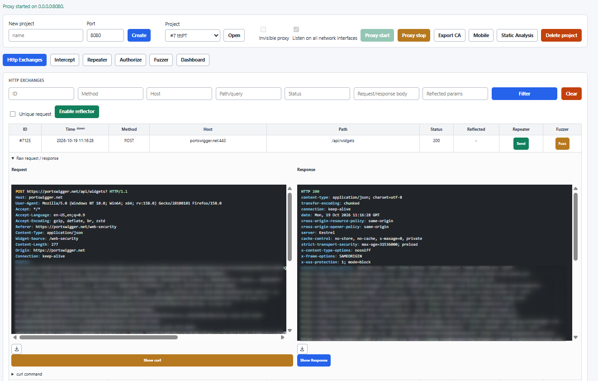
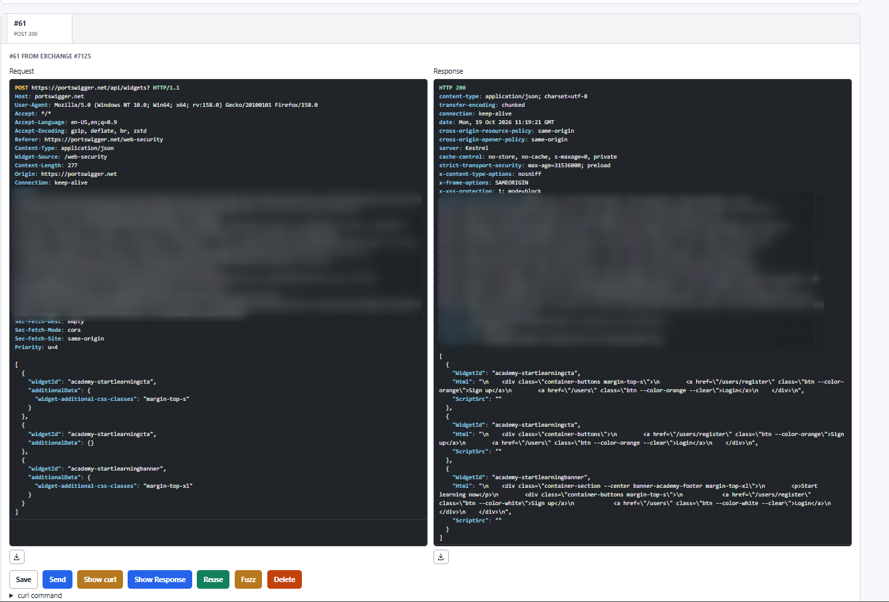
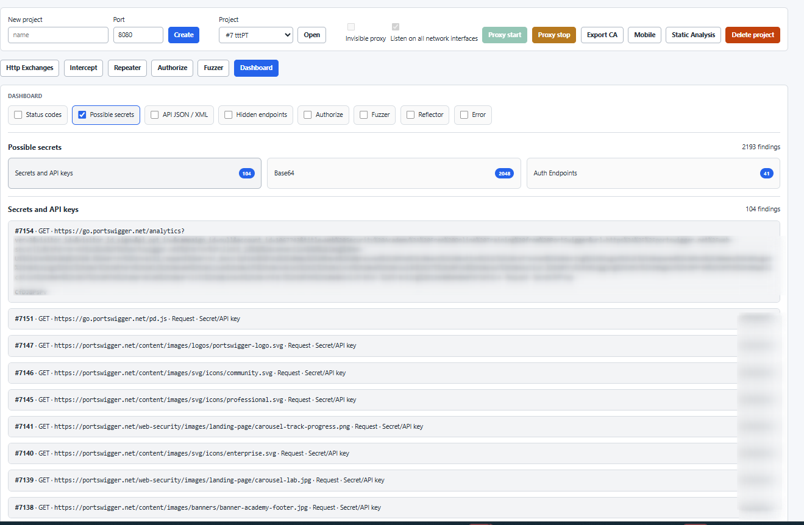

# DroidBoard

DroidBoard is a Python security testing application with a Flask web interface
and a Windows desktop launcher. It includes project management, an HTTP/HTTPS
proxy, traffic inspection, Repeater, Authorize, Reflector, Fuzzer, mobile tools,
and static analysis. The backend lives in `backend/app`; templates and static
assets live in `droidboard`. No separate frontend build is required.

## Screenshots

### HTTP Exchanges

The HTTP Exchanges view provides searchable request history and a side-by-side
inspection of raw requests and responses captured by the proxy.



### Repeater

Repeater lets you edit and resend individual HTTP requests, compare their
responses, and forward selected requests to other testing tools.



### Dashboard

The dashboard groups findings detected in captured traffic, such as possible
secrets, API keys, encoded data, authentication endpoints, and errors.



## Setup

Use Python 3.12 and install the application in a virtual environment:

```bash
python3 -m venv .venv
source .venv/bin/activate
python -m pip install -e ".[dev]"
```

On Windows:

```bat
py -3.12 -m venv .venv
.venv\Scripts\activate
python -m pip install -e ".[dev]"
```

`requirements.txt` is also available for installing pinned dependencies.
The default database is `data/arkadroid.sqlite3`; override it with `DATABASE_URL`.
Existing database names and `ARKADROID_*` environment settings remain supported.

## Droidboard Startup

Start the Flask board:

```bash
scripts/droidboard.sh start
```

On Windows:

```bat
scripts\droidboard.bat start
```

Start the Flask board and bind both the web interface and proxy to every
network interface:

```bash
scripts/droidboard.sh start --alliface
```

On Windows:

```bat
scripts\droidboard.bat start --alliface
```

Stop it:

```bash
scripts/droidboard.sh stop
```

On Windows:

```bat
scripts\droidboard.bat stop
```

By default the board runs on `http://127.0.0.1:5000`, writes its PID to
`data/droidboard.pid`, and writes logs to `data/droidboard.log`. The proxy also
binds to `127.0.0.1` by default. Use `--alliface` only when the board and proxy
must be reachable from other machines on the network.

You can override the board host and port:

```bash
DROIDBOARD_HOST=127.0.0.1 DROIDBOARD_PORT=5050 scripts/droidboard.sh start
```

You can override the proxy bind host without using `--alliface`:

```bash
DROIDBOARD_PROXY_HOST=0.0.0.0 scripts/droidboard.sh start
```

Droidboard reads configuration from environment variables and from the `.env`
file supported by the backend settings. The HTTP exchanges page size defaults to
20 rows and can be changed with:

```bash
DROIDBOARD_PAGE_SIZE=50
```

## Droidboard desktop for Windows

The desktop launcher embeds the existing Flask board in a native pywebview
window using Microsoft Edge WebView2. The backend starts automatically on a
random `127.0.0.1` port and stops when the window closes, along with the proxy.
Uploads and downloads (including CA exports) use the embedded browser.

Build on **Windows x64 with Python 3.12 and Inno Setup 6** from the repository root:

```powershell
powershell -ExecutionPolicy Bypass -File scripts\build-droidboard-windows.ps1
```

For specific installations, pass `-Python C:\path\to\python.exe` and/or
`-InnoSetup C:\path\to\ISCC.exe`. The script creates an isolated
`.venv-desktop` and generates `dist\Droidboard-Setup-windows-x64.exe`.

Distribute and run this single installer. It installs Droidboard for the current
user without requiring administrator privileges. Python and the application's
Python/native dependencies are included. The installer also contains Microsoft's
small Evergreen WebView2 bootstrapper: if WebView2 is missing it downloads and
installs the matching runtime. First installation therefore needs an internet
connection only on machines that do not already have WebView2.

The installer intentionally does not bundle mobile toolchains such as Android SDK,
ADB, emulators/AVDs, Java/JADX, apktool, aapt, OpenSSL, or an iOS sideloader. Mobile
features require separately installed tools and do not make the core installer
larger. The intermediate `dist\Droidboard` directory is consumed by the installer
and is not the distribution artifact.

The manual GitHub Actions workflow **Build Droidboard for Windows** also produces
the installer as a downloadable artifact after these files are pushed to GitHub.

### Code signing with a PFX certificate

Install SignTool from the Windows SDK, keep the PFX outside the repository, and
provide its password through the process environment so it is not written in the
script or shell history:

```powershell
$env:DROIDBOARD_SIGNING_PASSWORD = "your-PFX-password"
powershell -ExecutionPolicy Bypass -File scripts\build-droidboard-windows.ps1 `
  -CertificatePath C:\secure\codesigning.pfx `
  -TimestampUrl https://your-ca.example/rfc3161
Remove-Item Env:\DROIDBOARD_SIGNING_PASSWORD
```

Use the RFC 3161 timestamp URL supplied by the certificate authority. The build
signs and verifies both the inner `Droidboard.exe` and the final installer using
SHA-256. A passwordless PFX is also supported by leaving
`DROIDBOARD_SIGNING_PASSWORD` unset. Pass `-SignTool C:\path\to\signtool.exe` if
the Windows SDK tool cannot be discovered automatically. Never commit a PFX or
its password.

Desktop data is stored in `%LOCALAPPDATA%\Droidboard\data`, the optional `.env`
file in `%LOCALAPPDATA%\Droidboard`, and startup logs in
`%LOCALAPPDATA%\Droidboard\desktop.log`. Set `ARKADROID_PROJECT_ROOT` to use a
different writable directory; existing `DATABASE_URL` and `DATA_DIR` settings
remain supported. Existing repository data is not copied automatically. To migrate,
close both applications and copy the repository's `data` folder into
`%LOCALAPPDATA%\Droidboard` (including certificates, not just the SQLite file).
The desktop build never bundles captured traffic, certificates, or local config.

For development on Windows, install `pip install -e ".[desktop]"` and run
`python scripts\droidboard_desktop.py`. Optional mobile/static-analysis features
still require their external tools on `PATH`. The `pexpect`-based interactive iOS
sideloader remains unavailable on Windows. Closing the window interrupts active
work.

The workflow smoke-tests the frozen executable's backend and packaged assets without
opening a GUI. WebView2 rendering and native file dialogs still need an interactive
Windows smoke test. PyInstaller [requires a Windows build host](https://pyinstaller.org/en/stable/).

## Persistence and Logging

Persistence uses SQLite through SQLAlchemy. Intercepted requests are stored in
`http_exchanges`; relevant application calls are stored in `call_logs`.

Authorize plugin replays are stored in `authorize_exchanges`, separate from the
main HTTP history.

Repeater records created from the board are stored in `repeater_requests`, so
sent, edited, cloned, and deleted replay records persist across board sessions.

The `call_logs` table contains:

- `source`: call origin (`console`, `proxy`, `authorize`)
- `operation`: command or request
- `project_id`: related project, when available
- `exchange_id`: related HTTP exchange, when available
- `status`, `message`, `payload`
- `timestamp`

## Tests

```bash
python -m pytest backend/tests
```

`make run`, `make stop`, and `make test` launch, stop, and test DroidBoard.

## Disclaimer

DroidBoard is provided **as is**, without warranties of any kind, express or
implied. The software may contain defects, vulnerabilities, or other security
issues, and its use may expose systems or data to risk. Use it only in controlled
environments and on systems for which you have explicit authorization. You are
solely responsible for evaluating its suitability and security, and for any
consequences resulting from its use.
